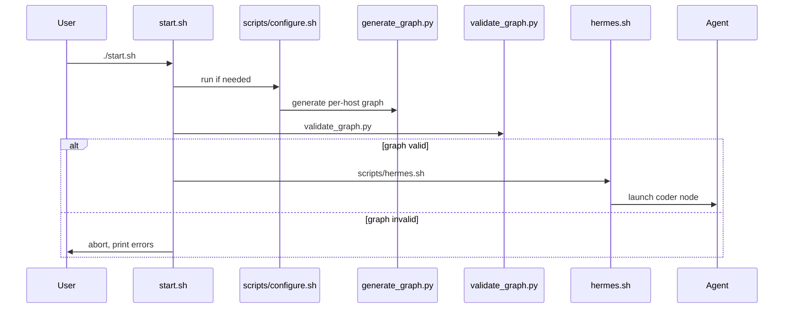

# Quick Start Guide for Familia

This guide walks you through the most common workflows for **Familia** – from installing the stack, launching the various components, to using the agent harnesses and configuration utilities.

---

## 1. Installation (one‑click)

```sh
# Linux / macOS / Termux (Android)
curl -fsSL https://raw.githubusercontent.com/brianreborn/familia/main/install.sh | sh
```

* The installer clones the repository into `~/familia` (override with `INSTALL_PREFIX`).
* It runs `scripts/configure.sh` which checks out all sub‑projects listed in `pins.txt`.
* By default it also starts the server (`./start.sh`). To skip the automatic start set `INSTALL_NO_START=1`.
* For unattended installs you can set `INSTALL_ACK=yes` to auto‑accept the contribution notice.

**Windows** – run `install\\windows\\install.bat` (wraps the PowerShell installer) and then `scripts\\windows\\start.bat`.

---

## 2. Core Runtime (`start.sh`)

`start.sh` boots the **router** (`code-bootstraps-llama.cpp/start.sh`). It supports several detach modes:

| DETACH_MODE | Behaviour |
|-------------|-----------|
| `foreground` | Runs the backend directly in the current shell (useful for debugging). |
| `nohup` | Starts the backend in the background, logs to `.cache/server.log`. |
| `tmux` / `screen` | Starts a persistent session named `familia-server`. |

On Termux the script auto‑selects the best available mode and acquires a wake‑lock so the server survives terminal closure.

```sh
# Example: run detached in a tmux session
DETACH_MODE=tmux ./start.sh
```

---

## 3. Model Management

### Add a model
```sh
./scripts/add-model.sh <hf-snapshot-dir>             # whole HF repo: README.md card, config.json, GGUFs, mmproj/draft
./scripts/add-model.sh <path-to-gguf> [--role ROLE]  # a lone GGUF; the role is inferred when omitted
./scripts/add-model.sh <role> <path-to-gguf>         # legacy form, still works
./scripts/add-model.sh --repo ORG/NAME --revision SHA --file F.gguf --card README.md --aux mmproj=mmproj.gguf
./scripts/add-model.sh --fetch ORG/NAME[@REV] --quant Q4_K_M   # opt-in download via hf/huggingface-cli
./scripts/add-model.sh --dry-run <dir>               # print the entry, write nothing
```
* Updates `code-bootstraps-llama.cpp/config/models-manifest.json` (adds the entry, or updates it in place for the same repo + file) and sets `model =` in the role's `[section]` of `models-preset.ini` (comments and sections kept).
* `--role`/`--type` is optional: it is inferred from the card front matter (`pipeline_tag`, `tags`, `library_name`, `base_model`), `config.json`, GGUF metadata (`decision.*`, `<arch>.pooling_type`, `general.name`), the filename, the `models/<role>/` directory and an existing manifest entry with the same sha256. The evidence is printed; if it is still ambiguous it asks on a TTY and otherwise exits 2.
* Records sha256 + bytes of every GGUF (main and auxiliary: `--aux KIND=PATH`, or `mmproj-*`/`*draft*` files found in the directory) and sha256 of the card and config files, plus license, base model, context length, RoPE, quant, chat template, stop tokens, and the card's recommended sampling settings (per thinking mode) and command lines (`card_defaults`, `card_sampling_modes`, `card_commands`, with the source line of each). Unknown values stay null and are listed. Model database requirement: #51.
* No network unless `--fetch` is given. `./scripts/add-model.sh --help` lists every flag.

### Select a model for a role (interactive)
```sh
./scripts/select-model.sh
```
Shows a menu of available models for each role.

### Enable / Disable a model
```sh
./scripts/toggle-model.sh <model-name> --enable   # or --disable
```
The manifest now contains an `"enabled": true|false` flag, which `start.sh` respects.

---

## 4. Graph Generation & Validation

```sh
# Generate per‑host graph files (graph.yaml, host‑specific .yaml)
python3 ./scripts/generate_graph.py

# Validate the graph against the current host and model files
./scripts/validate_graph.py --graph graph.yaml
```
The validator aborts loudly if a model file is missing, a checksum fails, or a runtime architecture mismatch occurs.

---

## 5. Hermes Harness (`scripts/hermes.sh`)

Hermes is the **coder** agent harness. It:
1. Validates the graph.
2. Renders a Hermes configuration under `~/.cache/familia/hermes-<agent>`.
3. Starts the `llama-server` for the `coder` node if it is not already up.

Typical usage:
```sh
scripts/hermes.sh          # launch full harness (validation + server)
scripts/hermes.sh --render-only   # only write the config, do not start server
```
The harness automatically sets per‑slot `context_length`, enables compression, and pins the correct runtime binary.

---

## 6. Browser‑based Settings Panel (`scripts/panel.py`)

A small Flask UI runs on port **9932** and proxies the `code-bootstraps-llama.cpp` panel.
```sh
python3 scripts/panel.py
```
Open `http://127.0.0.1:9932` to adjust environment variables, view logs, and edit the graph via a visual editor (`ui/graph‑editor`).

---

## 7. Agent Harness (`agent.py`)

`agent.py` is the generic entry‑point for any **agent** defined in the graph (e.g., `hermes-agent`, `reach`, custom bots). It reads the generated configuration, connects to the router, and starts the model server for the node.
```sh
python3 scripts/agent.py --node coder
```
Key flags:
* `--node <name>` – the graph node to launch.
* `--dry-run` – only validate configuration, do not start the model.

---

## 8. Discovering New Models

The repository ships helpers to discover models from external sources:
| Tool | Description |
|------|-------------|
| `scripts/find-model-tweets.py` | Search recent Twitter mentions for model names. |
| `scripts/find-model-hf.py` | List newly‑uploaded HuggingFace models. |
| `scripts/find-repos-github.py` | Find GitHub repositories that contain GGUF weights. |
| `scripts/model-watcher.py` | Periodically run the above searches and update a watch‑list. |

Run any of them directly or schedule with `scripts/install-watcher.sh`.

---

## 9. Benchmarks

```sh
./scripts/benchmark.sh
```
Runs a short latency benchmark (256‑token generation) for every enabled model and writes results to `benchmark.log`.

---

## 10. Common Environment Variables

| Variable | Meaning |
|----------|---------|
| `PORT` | HTTP port for the UI (default `9931`). |
| `PROFILE` | `lowram` | `moderate` | `default` – selects preset resource limits. |
| `CTX` / `CODER_CTX` | Context window size per slot. |
| `DETACH_MODE` | `foreground` | `nohup` | `tmux` | `screen`. |
| `TWITTER_BEARER`, `GITHUB_TOKEN` | API credentials for discovery scripts. |

---

## 11. Diagrams

Below are mermaid diagrams that visualise the overall architecture and the typical startup flow.

### System Architecture
```mermaid
flowchart TD
    UI[Web UI (port 9931)] -->|REST| Router[Router / start.sh]
    Router -->|gRPC| ModelServer[Model Servers (llama‑cpp)]
    Router -->|gRPC| Agent[Agents (hermes, reach, …)]
    Router -->|HTTP| Panel[Settings Panel (port 9932)]
    subgraph Discovery
        Tweets[Twitter Search]
        HF[HuggingFace Search]
        GH[GitHub Search]
    end
    Discovery -->|updates| Manifest[models‑manifest.json]
```

### Startup Sequence


---

## 12. Frequently Asked Questions

* **"Why does the embed role crash?**
  * The embed role points at `embeddinggemma‑2`. If the GGUF file is missing or disabled, `start.sh` now skips the embed server and prints a warning instead of aborting.
* **"How do I toggle a model without editing JSON?**
  * Use `./scripts/toggle-model.sh <model-name> --disable`.
* **"Can I run the server in the background on Termux?**
  * Yes – simply run `DETACH_MODE=tmux ./start.sh`. The script will acquire a wake‑lock automatically.

---

## 13. Next Steps
1. Review the quick‑start steps above and ensure the environment variables you need are set.
2. Run `./scripts/add-model.sh <hf-snapshot-dir>` (or `<path-to-gguf>`) for any custom model you want to use; add `--dry-run` first to see what it infers.
3. Launch the UI (`http://127.0.0.1:9931`) and start chatting with the default `chat` route.
4. Explore the **graph editor** (via the Settings Panel) to add new routes such as `embed` or `rerank`.

---

*Created by Antigravity – iterated to cover all core components.*
