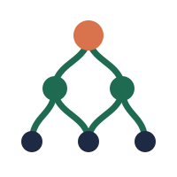

# familia



**Federated Agents Mesh for Intelligent Local Interoperable Autonomy** · *Federación de Agentes Multi-Inteligentes Locales Interoperables Autónomos*

Your models and data stay on your machines. A file, context, or result moves across a boundary only when you tell it to.

familia is a **topology coordinator**. It doesn't replace your inference server or your agents. It pins them, checks them out side by side, and wires them into one graph you control: llama.cpp model servers, the green-roomz alias gateway, the green-agentz fleet, and agents such as hermes-agent, across the machines you own.

> **Status:** pre-release (`v0.1.0-rc2`). Linux is the tested platform. **Want to help test? Start with [TESTING.md](TESTING.md).** See [Platform status](#platform-status) and [Known issues](docs/known-issues.md).

**Projects familia coordinates:** [code-bootstraps-llama.cpp](https://github.com/brianreborn/code-bootstraps-llama.cpp) provides model serving and bootstrap tooling; [green-roomz](https://github.com/brianreborn/green-roomz) provides the alias gateway; [green-agentz](https://github.com/brianreborn/green-agentz) provides the agent fleet; [Agent-Reach](https://github.com/Panniantong/Agent-Reach) provides optional reach tools; and [nace-ai/llama.cpp](https://github.com/nace-ai/llama.cpp/tree/edlm) is the experimental DReX-DLM runtime. Their repositories and licenses remain independent; familia's [`pins.txt`](pins.txt) keeps the selected revisions together. [green-agency](https://github.com/brianreborn/green-agency) is retired and retained only for historical specifications.

---

## Skills: why familia wins hearts, minds and computers

A small model running on an old laptop or phone does far more when it has
good instructions for the job in front of it. Skills provide those
instructions: a skill is a folder with a `SKILL.md`, sometimes with scripts,
that teaches an agent one task, such as probing a host or formatting a
manuscript. familia treats skills as a headline feature.

- **Picked from a menu.** Choose `./familia`, then **Skills**, and switch
  skills on or off for an agent. Scripts can do the same with
  `scripts/skills.py enable ID`.
- **License-checked.** Before anything is enabled, installed or started,
  `scripts/licenses.py` shows every license your selection brings in. Unknown
  or restrictive licenses are listed first, and nothing goes ahead until you
  accept ([docs/licenses.md](docs/licenses.md)).
- **Pinned.** Each skill is tied to an exact commit in `skills/catalog.json`.
- **Living in green-zkillz.** Bundled skills live in green-zkillz, the skills
  tree of [green-agentz](https://github.com/brianreborn/green-agentz).
  familia's catalog is the selection layer over it.

Today the catalog has the 7 green-zkillz skills plus 2 surveyed sources (one
not vendored yet, one license-blocked). We haven't measured how much skills
improve small-model results yet. Details are in [docs/skills.md](docs/skills.md).

---

## Quick start

```sh
curl -fsSL https://raw.githubusercontent.com/brianreborn/familia/main/install.sh | sh
```

That clones familia into `~/familia`, shows the license review, syncs the pinned sub-projects and starts the active local topology declared in `graph.yaml`. You type `yes` once to acknowledge the voluntary contribution notice (`INSTALL_ACK=yes` for unattended installs); paying is never required. The graph gateway is loopback-only at **http://127.0.0.1:9931**; use `GET /v1/models` to see the local aliases.

**What now?** Run `./familia` in the checkout. It opens a menu grouped by task (Set up, Skills, Models, Agents, Harness², Test, Hosts, three Advanced groups, Help), and each item shows the command it runs (on Windows, `familia.cmd`). Every user-facing script is in it; [docs/commands.md](docs/commands.md) lists every item and the few scripts left out on purpose, and `./familia-menu.sh --list` prints them all. Type `/word` at any menu prompt to search every group (`n`/`N` for next/previous, like `less`), or run `./familia search WORD`. Every item is also a command: `./familia help` lists them (`./familia skills list`, `./familia model params coder`, `./familia --dry-run serve coder`), and `man ./man/familia.1` is the manual.

Windows, per-graph-node installers, and everything after the first start: **[QUICKSTART.md](QUICKSTART.md)**, then [MANUAL.md](MANUAL.md).

---

## Architecture

familia is a **graph**. Nodes have named *hooks*, and hooks connect in pairs. Data moves along an edge. Control messages are addressed to a node and don't have to follow the edges. This is the NETGRAPH split: the data plane is the graph, and the control plane is a message you can send to any node while data keeps moving.

```
               ┌───────────────── you ─────────────────┐
               │   OpenAI API :9931 · agents / TUIs     │
               └───────────┬───────────────────────────┘
                           │  route names: chat · coder · route · translate · …
                ┌──────────▼──────────┐
                │  room  (green-roomz)│  one stable alias → one backend; HANDOFF back to `route`
                └──────────┬──────────┘
          ┌────────────────┼──────────────────┐
   ┌──────▼──────┐  ┌──────▼──────┐   ┌───────▼───────┐
   │ model chat  │  │ model coder │   │ model route   │   llama-server (router mode)
   └──────┬──────┘  └──────┬──────┘   └───────────────┘   code-bootstraps-llama.cpp
          │ weights         │ kv
   ┌──────▼─────────────────▼──────┐        ┌──────────────┐   ┌─────────────┐
   │ store  (local · ssh · nfs ·   │        │ agent / swarm│   │ reach       │
   │        rsync · torrent · zfs) │        │ green-agentz │   │ Agent-Reach │
   └───────────────────────────────┘        └──────────────┘   └─────────────┘
```

- **Node types** (from `pins.txt`): `model`, `agent`, `agency`, `room`, `swarm`, `store`, `reach`.
- **Transports**: `local`, `ssh`, `nfs`, `rsync`, `bittorrent`, `zfs` are the declared edge kinds. Only two have code, as an opt-in proof of concept: an SSH nexus and a private BitTorrent tracker (`meshes:` in the graph, [docs/transport-poc.md](docs/transport-poc.md)). The rest are names only.
- **Route names** are single English words for the job: `chat` (front door), `coder` (handoff target), `route` (small resident dispatcher), `translate`. Specialist routes (`vision`, `transcribe`, `speak`, `draw`, `embed`, `rerank`, `safety`, `guard`) exist only when they are declared and their pinned weights are on disk. A file appearing on disk doesn't create a route by itself.
- **The user owns every edge.** An environment variable, a command-line flag, or a saved setting always wins. The system may *suggest* an edge, and it never opens one on its own.
- **Configuration drives startup.** [`graph.yaml`](graph.yaml) declares model nodes, aliases and gateways; [`scripts/validate_graph.py`](scripts/validate_graph.py) checks model/runtime facts and placement. `start.sh` starts active nodes assigned to the exact local graph host, waits for their health endpoints, then starts the declared loopback Green-Roomz graph proxy for local aliases. Remote nodes and gateways are reported but never started or contacted without consent. Use `--host NAME` when the local hostname is not an exact graph-host key. See [docs/configuration-graph.md](docs/configuration-graph.md).

For the full design (transaction blocks, `/local` and `/remote`, snapshots as cache coherence, least privilege), read [DESIGN.md](DESIGN.md).

---

## Sub-projects

The sub-projects keep their own repositories and licenses. familia pins each one by revision in [`pins.txt`](pins.txt). They are pins, not submodules. Nothing is vendored. `scripts/configure.sh` checks them out next to the top-level tree, or links a sibling checkout that already exists.

| Pin (`pins.txt`) | Role | Repository |
|---|---|---|
| `code-bootstraps-llama.cpp` | Models and the agent: `llama-server` router, model fetch/verify, `/local`, `/remote`, installers, settings panel | [brianreborn/code-bootstraps-llama.cpp](https://github.com/brianreborn/code-bootstraps-llama.cpp) |
| `green-roomz` | Alias gateway, including familia's graph-proxy mode for local declared routes | [brianreborn/green-roomz](https://github.com/brianreborn/green-roomz) |
| `green-agentz` | Agent fleet (green-brainz, green-fleetz, green-zkillz) | [brianreborn/green-agentz](https://github.com/brianreborn/green-agentz) |
| `green-agency` | **Retired.** Kept for historical specs; not the fleet | [brianreborn/green-agency](https://github.com/brianreborn/green-agency) |
| `agent-reach` | External reach tools, pinned and not vendored | [Panniantong/Agent-Reach](https://github.com/Panniantong/Agent-Reach) |
| `llama-server__nace-ai__edlm` | Experimental runtime: DReX-DLM diffusion engine. Cloned only when an `ENGINE_*` setting asks for it | [nace-ai/llama.cpp](https://github.com/nace-ai/llama.cpp) (branch `edlm`) |

**Used but not pinned:** [hermes-agent](https://github.com/NousResearch/hermes-agent). Always run it through the graph harness, `scripts/hermes.sh`, never as stock `hermes`. The stock `~/.hermes` config has compression off and points at small-context models, which fails with HTTP 400 on long turns ([#19](https://github.com/brianreborn/familia/issues/19)). The harness renders its own config (65,536-token context on the `coder` node, compression on, auxiliary tasks on local nodes) and only reads `~/.hermes`. Commands: [QUICKSTART.md](QUICKSTART.md#always-run-hermes-through-the-harness).

Alternative engine builds follow the `<executable>__<author>__<branch>` naming scheme (for example `llama-server__ggerganov__master`), and each build lives in its own `bin/llama__<author>__<branch>/` directory so shared libraries can't collide. Building alternative engines from these pins is still TBD; `configure.sh` only clones them. Separately, the graph runs **official llama.cpp release builds side by side**: `b11374` serves `coder` (qwen35) and `b11539` is load-tested for `embed` (embeddinggemma-2, deferred in [#38](https://github.com/brianreborn/familia/issues/38)), each declared under `runtimes:` in `graph.yaml` with the architectures it was load-tested on. A node whose GGUF architecture isn't listed for its runtime fails validation.

---

## Configuration

Shell environment variables always take precedence over saved settings.

- **Settings panel (simple window):** `./familia panel` opens http://127.0.0.1:9932/ in your browser. It works with a mouse, a keyboard alone, a single switch or a screen reader (big buttons, short pages, no time limits, no JavaScript). It covers skills, license acceptance, the hermes mode, Harness2, a read-only view of each model's launch parameters, and the launcher settings. Every change is previewed before it is saved and can be undone. It listens on this computer only; from elsewhere use `ssh -L 9932:127.0.0.1:9932 HOST`. Details: [docs/panel.md](docs/panel.md).
- **Settings in the terminal:** `sh scripts/configure.sh -i`. Without `-i` it only syncs pins.
- **Standalone bootstrap UI:** use `./start.sh --bootstrap` to explicitly run the legacy code-bootstraps-llama.cpp router. Its `PORT`, `PROFILE`, `CTX`, `CODER_CTX`, `MODELS_MAX`, and `TOOLS` settings do not configure graph nodes.
- **Session control:** `DETACH_MODE=foreground|nohup|tmux|screen|screen-attached ./start.sh`. Foreground is the default, including on Termux; Termux takes a wake lock when `termux-wake-lock` is installed but does not silently background the graph. Screen sessions are named `familia-server`; `screen-attached` starts attached with 10,000 lines of scrollback (`Ctrl-A`, then `[` to review history; `Ctrl-A`, then `D` to detach; `screen -r familia-server` to resume). nohup logs go to `.cache/graph.log`.

**FreeBSD note:** `angel` remains unmeasured and has no active graph nodes, so `./start.sh --dry-run --host angel` reports that nothing is eligible to start. For now, install no packages on FreeBSD and do not use `familia install`; build the pinned llama.cpp checkout from source with `BUILD_DIR=build-freebsd GPU=off scripts/build-linux.sh` in `code-bootstraps-llama.cpp`. Measure the host and explicitly place nodes before expecting graph startup there.

---

## Implementation status

Everything below is on `main`. "Planned (#N)" means tracked in that issue and not done yet.

| Feature | Status |
|---|---|
| Declarative graph `graph.yaml` (typed schema v2, multi-host, GPU fields, speculative edges, `pentests` launch-test-only type) + `scripts/validate_graph.py` | Implemented. Fails on schema, runtime, GGUF arch, `context_length`, prompt-cache size and RAM overcommit; the RAM reserve and small-host floor are warnings ([docs/ram-safety.md](docs/ram-safety.md)) |
| Model selection: `selection: default\|fallback` per node | Implemented (`qodesh-resident`, Qwen3.5-2B, is a user-selectable fallback; SmolLM2 stays the qodesh default) |
| hermes harness `scripts/hermes.sh` / `hermes_harness.py` | Implemented, with graph mode (default) and single-model mode (`--model NODE`, 64K floor); live `--selftest-compaction` on miryam planned ([#42](https://github.com/brianreborn/familia/issues/42)) |
| Self-improving harnesses: Harness² over `harnesses:` descriptors, `self_improve:` settings, `scripts/harness2.py` | Experimental, off by default, independent of hermes. Any model role is allowed; agents explicitly assigned to pentest configurations remain excluded. See [docs/harness2.md](docs/harness2.md) ([#65](https://github.com/brianreborn/familia/issues/65)) |
| Official Hermes plugins (MCP + Skill) bridged into rendered HERMES_HOME | Opt-in `agents.<name>.plugins`; see [docs/hermes-plugins.md](docs/hermes-plugins.md) ([#92](https://github.com/brianreborn/familia/issues/92)) |
| Harness slimming (lean aux drop + short `harness/base`) | [docs/harness-slimming.md](docs/harness-slimming.md) ([#89](https://github.com/brianreborn/familia/issues/89); coordinates with #85) |
| Light-to-heavy escalation (`escalates_to`, `escalation: {mode: off\|suggest\|auto}`, `scripts/escalate.py`, `hermes.sh --escalate`) | Implemented behind a flag, default `suggest`, tested against mock servers. green-roomz router hookup, live swap, reachability probe and live end-to-end run planned ([#39](https://github.com/brianreborn/familia/issues/39)). See [docs/escalation.md](docs/escalation.md) |
| Side-by-side pinned llama.cpp runtimes | Implemented |
| RAM safety (`reserve_ram_mib`, memcap scope in `scripts/serve.sh`, earlyoom+zram on miryam) | Implemented; 4 GiB swapfile on miryam planned ([#43](https://github.com/brianreborn/familia/issues/43)) |
| Vulkan `-ngl 0` workaround (`GGML_VK_VISIBLE_DEVICES=` exported when a node has no GPU layers) | Implemented in `scripts/serve.sh` and the harness; live verification planned ([#40](https://github.com/brianreborn/familia/issues/40)). Not in Windows `serve.ps1` |
| Prompt cache sized per profile (lowram 768 / moderate 1024 / default 2048 MiB, at most a quarter of free RAM; code-bootstraps-llama.cpp #16) | Implemented in the pinned code-bootstraps; graph nodes set `cache_ram_mib` explicitly. Live reuse check planned ([#41](https://github.com/brianreborn/familia/issues/41)) |
| Measured model/hardware registry (`registry/records.jsonl`, `scripts/registry.py`), coarse binary-search tuning | Implemented, see [docs/model-registry.md](docs/model-registry.md) |
| Model database from the full pinned HF repo (`registry/models/`, `scripts/model_db.py`, `add-model.sh --fetch`); card sampling as launch defaults, overrides need reasons (#51) | Implemented, see [docs/model-database.md](docs/model-database.md); RoPE/stop/template recorded, not yet applied |
| `add-model.sh`: HF snapshot dirs, auxiliary models (`--aux`), inferred role | Implemented |
| One-click installers (Windows, desktop Linux/macOS, Termux) + Windows startup | Implemented, see [docs/install.md](docs/install.md), [docs/windows.md](docs/windows.md). Old-device lowram/non-AVX smoke planned ([#48](https://github.com/brianreborn/familia/issues/48)) |
| Legacy GPU decision node (GeForce 8600 GT, sm_11 PTX) | Measured; tuning notes in [docs/perf/pgo-followup.md](docs/perf/pgo-followup.md) |
| Transports PoC (SSH nexus, private BitTorrent tracker), C2C stage 1 `kv_ship` | Opt-in proof of concept (loopback- and cross-host-tested) |
| `scripts/scale_down.py`, LittleBit reference runtime | Implemented (LittleBit is correctness-only) |
| `isolated_remote` compute | Design doc plus the `scripts/isolated/hfchat.py` adapter; blocked on Hugging Face credits ([#36](https://github.com/brianreborn/familia/issues/36)) |
| Pentest roles | Launch-tested only, with tools disabled two independent ways (see [REQUIREMENTS.md](REQUIREMENTS.md)) |

---

## Platform status

| Platform | Status |
|---|---|
| Linux x86_64 | Tested |
| Termux (Android) | Server runs; detach and wake lock handled by `start.sh`. The Android fleet scripts are fixed (#14, #15, #18). The phones are out of range for now; the next measurement round is planned ([#46](https://github.com/brianreborn/familia/issues/46)) |
| macOS | Expected to work through the POSIX installer; untested |
| Windows | One-click installer `install\windows\install.bat` + `scripts\windows\start.bat`; measured on qodesh (Windows 10, non-AVX Athlon II X2) |

---

## Safety model

- **`/local` and `/remote`** (provided by code-bootstraps-llama.cpp's agent). `/local` runs local TUIs (grok, agy, claude, codex, `exec`) under your own user. `/remote` is an advisor for stuck sessions. It never receives your local tools or API key, and auto mode is off until `/remote on`.
- **Transactions:** `begin`, `commit`, `rollback`, `status`. Rollback undoes declared local writes from snapshot before-images. It can't recall a reply or tool call that has already left the machine, and `status` reports that case as `heuristic`.
- **Snapshots as cache coherence:** KV and slot dumps are tied to the exact engine build that wrote them. A different branch or engine gets the cold filesystem state only, and its KV is recomputed.
- **Least privilege:** everything runs as your user. There are no `NOPASSWD` sudo rules. A helper that needs one right uses it and drops it.

---

## Documentation

Start with [QUICKSTART.md](QUICKSTART.md), then [MANUAL.md](MANUAL.md).

| Doc | What's in it |
|---|---|
| [QUICKSTART.md](QUICKSTART.md) | Install, validate, start, add a model, test |
| [MANUAL.md](MANUAL.md) | Settings, detaching, models, escalation, RAM safety, Windows |
| [TESTING.md](TESTING.md) | Testing on your own hardware and reporting back |
| [DESIGN.md](DESIGN.md) | The graph, transactions, transports, snapshots |
| [REQUIREMENTS.md](REQUIREMENTS.md) | Requirements and their status |
| [LESSONS-LEARNED.md](LESSONS-LEARNED.md) | What went wrong before, and the rule that came out of it |
| [docs/graph-types.md](docs/graph-types.md) | Every `graph.yaml` section and the validator's rules |
| [docs/configuration-graph.md](docs/configuration-graph.md) | Why the graph exists, what it checks, what is still open |
| [docs/model-database.md](docs/model-database.md) | Model entries from the full pinned HF repo |
| [docs/model-registry.md](docs/model-registry.md) | Measured results and hardware profiles |
| [docs/models-catalog.md](docs/models-catalog.md) | Every model in use or under consideration |
| [docs/escalation.md](docs/escalation.md) | Light-to-heavy model escalation |
| [docs/ram-safety.md](docs/ram-safety.md) | RAM reserve rule and protections |
| [docs/monitoring.md](docs/monitoring.md) | `./familia-monitor`: SSH-based live console for every host, with process-death alerts |
| [docs/install.md](docs/install.md), [docs/windows.md](docs/windows.md) | Installers and Windows startup |
| [docs/known-issues.md](docs/known-issues.md) | Current problems and workarounds |
| [docs/HANDOFF.md](docs/HANDOFF.md), [docs/offline-test-plan.md](docs/offline-test-plan.md) | Open work and the tests that resume it |
| [docs/announcements/](docs/announcements/) | Release-note and announcement **drafts** (not published) |

---

## License

Code in this repository is under the **Light-ware License** ([LICENSE](LICENSE)): the 4-clause BSD license plus a voluntary invitation to help with rent, groceries, or utilities. Declining doesn't affect your rights. Required advertising notice: *"This product includes software developed by Brian Fundakowski Feldman."*

Sub-checkouts keep their own licenses (for example, llama.cpp stays MIT). Model weights carry their own licenses. The default general model's license, for example, is printed when it is downloaded.

---

## Issues

| Area | Tracker |
|---|---|
| familia topology and graph | https://github.com/brianreborn/familia/issues |
| Models, server, installers, agent | https://github.com/brianreborn/code-bootstraps-llama.cpp/issues |
| green-roomz gateway | https://github.com/brianreborn/green-roomz/issues |
| green-agentz fleet | https://github.com/brianreborn/green-agentz/issues |
| green-agency (retired) | https://github.com/brianreborn/green-agency/issues |

Agent-Reach issues belong on [Panniantong/Agent-Reach](https://github.com/Panniantong/Agent-Reach). Upstream llama.cpp issues belong on [ggml-org/llama.cpp](https://github.com/ggml-org/llama.cpp).
